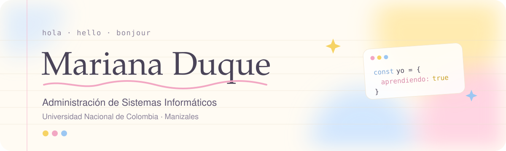

  
 
    
  

Soy Mariana, estudiante de octavo semestre de Administración de Sistemas Informáticos en la Universidad Nacional de Colombia, sede Manizales.

Antes de escribir código enseñé inglés y español, y eso me dejó una costumbre: si no lo puedo explicar con claridad, todavía no lo entiendo del todo. Hoy aplico esa idea al software. Me interesan el desarrollo web y la inteligencia artificial, y disfruto convertir un problema confuso en algo ordenado que otra persona pueda usar sin pensarlo dos veces.

Este perfil es mi cuaderno de trabajo: aquí guardo lo que construyo mientras aprendo.

Lo que me trae aquí
Desarrollo web. Me gusta la parte en la que una idea se vuelve una pantalla que alguien puede tocar.
Inteligencia artificial. Quiero entender cómo integrarla en aplicaciones que de verdad ayuden a las personas.

Estoy buscando mi primera experiencia profesional en desarrollo de software, en un equipo donde pueda aportar y seguir aprendiendo.

Con qué trabajo

Para construir lo que se ve    HTML y CSS son mi base. JavaScript, React y Next.js los estoy afianzando proyecto a proyecto.

Para lo que pasa detrás     Bases de datos SQL en nivel básico a intermedio. Con Laravel hice mis primeros CRUD.

Para pensar antes de programar     Modelado y diseño de software, y trabajo por iteraciones.

Para el día a día  

Idiomas
  

Estudié francés en la Alianza Colombo Francesa de Manizales entre 2023 y 2025.

Certificaciones
Linux Essentials · Cisco Networking Academy, 2025
NDG Linux Unhatched · Cisco Networking Academy, 2023
Scrum Fundamentals Certified, 2026
Francés B1 · Alianza Colombo Francesa de Manizales, 2025

Hablemos

Si tienes un proyecto, una oportunidad o simplemente quieres conversar sobre desarrollo web o IA, escríbeme a mduquegi@unal.edu.co o búscame en LinkedIn. Respondo en español, inglés o francés.

  
  

